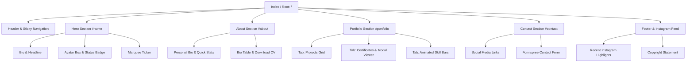

# Product Requirements Document (PRD)

**Project Name:** Mohammad Azhriel Personal Portfolio Website  
**Author:** Mohammad Azhriel Muari Fullah  
**Target Platform:** Web (Desktop, Tablet, Mobile)  
**Deployment Target:** Vercel (Static Hosting / Vite SPA)  
**Version:** 2.0.0 (Migrasi PHP → React)  
**Status:** In Development (Migration)  
**Design Reference:** [`design.md`](./design.md)  

---

## 1. Executive Summary

Website portofolio ini dirancang sebagai platform representasi profesional digital untuk **Mohammad Azhriel Muari Fullah**, mahasiswa Sistem Informasi di Politeknik Negeri Subang. Portofolio ini mengusung estetika **Neo-Brutalism** modern dengan arsitektur **React Component-Based** yang ringan, responsif, dan teroptimasi untuk performa tinggi.

Tujuan utama website ini adalah menampilkan identitas keahlian (Frontend, Backend, UI/UX Design, Videografi), rekam jejak proyek unggulan, sertifikat penghargaan, serta memfasilitasi interaksi langsung dengan perekrut, mitra industri, dan klien potensial untuk peluang magang (*internship*) maupun *freelance*.

---

## 2. Target Audience & User Personas

| Segmen Pengguna | Kebutuhan Utama | Ekspektasi Perilaku |
| :--- | :--- | :--- |
| **Tech Recruiter / HRD** | Menilai profil kandidat, pengalaman, latar belakang pendidikan, serta mengunduh CV resmi. | Membutuhkan navigasi cepat ke informasi esensial (Skills, CV Download, Kontak) dalam waktu < 30 detik. |
| **Engineering Lead / Tech Client** | Memeriksa kualitas kode, stack teknologi, arsitektur proyek nyata, dan tautan repositori GitHub. | Mengeksplorasi kartu proyek, mengecek live demo/GitHub, dan menguji responsivitas antarmuka. |
| **Design Lead / Kolaborator Kreatif** | Menilai estetika visual, kemampuan UI/UX (Figma), kreativitas, dan portofolio multimedia/videografi. | Memperhatikan konsistensi visual, interaksi mikro (hover/motion), serta melihat prototype Figma. |

---

## 3. Product Goals & Success Metrics (KPIs)

### 3.1 Business & Personal Goals
- **Lead Generation:** Menerima tawaran magang (*internship*) industri dan proyek *freelance*.
- **Personal Branding:** Membangun citra profesional sebagai *full-stack enthusiast* dan desainer antarmuka yang kompeten.
- **Social Proof:** Mendokumentasikan sertifikasi dan pencapaian kompetisi secara terverifikasi.

### 3.2 Success Metrics (KPIs)
- **Conversion Rate:** Frekuensi klik "Download CV" dan pengiriman form kontak Formspree.
- **Engagement:** Nilai *bounce rate* < 40% dan rata-rata durasi kunjungan > 1.5 menit.
- **Performance:** Skor Google Lighthouse > 90 pada sektor Performance, Accessibility, Best Practices, dan SEO.

---

## 4. Information Architecture & Site Map

Struktur halaman adalah *Single Page Application (SPA)* berbasis *modular anchor scrolling*:



---

## 5. Detailed Feature Specifications

### 5.1 Navigation Bar (`src/components/Header.jsx`)
- **Brand Logo:** Menampilkan teks `My Portfolio.` dengan penekanan titik aksen. Klik mengarahkan kembali ke `#home`.
- **Navigation Links:** Tautan *smooth-scroll* ke 4 section utama:
  - `Home` (`#home`)
  - `About` (`#about`)
  - `Portfolio` (`#portfolio`)
  - `Contact` (`#contact`)
- **Active Scroll Spy:** Mengaktifkan status `.active` pada link menu sesuai posisi *viewport* pengguna saat ini.
- **Responsive Hamburger Menu:** Toggle tombol hamburger pada layar *mobile* (≤ 768px) yang membuka drawer menu navigasi. Menu tertutup otomatis saat link diklik.

### 5.2 Hero Section (`src/components/Hero.jsx`)
- **Location Tag:** Menampilkan chip identitas lokasi: `📍 Subang, Jawa Barat`.
- **Headline Display:** Nama lengkap dengan aksen warna kontras Neo-brutalist.
- **Role & Description:** Deskripsi singkat peran akademis dan fokus pengembangan sistem digital.
- **Call-to-Action (CTA) Buttons:**
  - *Primary CTA:* `Lihat Portfolio →` (anchor ke `#portfolio`).
  - *Secondary CTA:* `Hubungi Saya` (anchor ke `#contact`).
- **Avatar Unit:**
  - Bingkai foto berbingkai tebal dengan elemen dekorasi grafis bayangan keras.
  - *Status Badge:* Indikator ketersediaan dinamis: `🟢 Open to Internship`.
- **Infinite Marquee Ticker:** Logo Berjalan horizontal tak berujung (*infinite scroll*) yang menampilkan stack teknologi dan kemampuan inti (HTML, CSS, JS, PHP, MySQL, Laravel,React, UI/UX, Problem Solving) dipisahkan oleh simbol bintang (`★`).

### 5.3 About Me Section (`src/components/About.jsx`)
- **Section Heading:** Penomoran modular `02` dan judul `About Me`.
- **Narrative Story:** Deskripsi singkat filosofi pengembangan: memecahkan masalah nyata dengan solusi yang mudah digunakan.
- **Stat Cards Grid:** Kartu metrik cepat:
  - Semester (5)
  - Proyek Selesai (7+)
  - Sertifikat (3+)
  - Motivasi/Semangat (∞)
- **Profile Detail Table:** Informasi struktural (Nama, Institusi, Program Studi, Lokasi, Status, Minat, Kemahiran Bahasa).
- **Direct CV Download:** Tombol download berkas Curriculum Vitae format PDF (`public/files/CV_MOHAMMAD AZHRIEL.pdf`) lengkap dengan ikon unduhan.

### 5.4 Portfolio Showcase Section (`src/components/Portfolio/`)
- **Section Heading:** Penomoran modular `03` dan judul `Portfolio`.
- **Interactive Tabs Controller:** 3 tab navigasi tanpa me-reload halaman:
  1. **🗂 Projects:**
     - Menampilkan kartu proyek modular (*DelimaCare dengan laravel*, *e-commerce dengan laravel, payment gateway dan integrasi map*, *Synapse UI/UX*,*website landing page toko frozen food dengan next js dan integrasi WA*,  *aplikasi kasir dengan react native*, *game website football simulator dengan react*, dan *website jasa pembuatan website*).
     - Setiap kartu memuat thumbnail, daftar teknologi pendukung (*tags*), ringkasan fungsional, dan tautan repositori GitHub / Figma / YouTube.
  2. **🏆 Certificates:**
     - Menampilkan daftar prestasi (Juara Harapan 1 UI/UX Polman Bandung 2025, Juara Harapan 1 Videografi Kesejarahan 2024, Penghargaan Peserta 2025).
     - **Modal Lightbox Preview:** Setiap sertifikat dapat diklik untuk membuka modal tampilan resolusi penuh beserta *caption*, menonaktifkan *scroll* background untuk kenyamanan inspeksi.
  3. **⚡ Skills:**
     - Dikelompokkan ke dalam kategori: *Frontend Development*, *Backend Development*, dan *UI/UX Design*.
     - Dilengkapi *animated percentage progress bars* yang berjalan otomatis saat tab diaktifkan.

### 5.5 Contact & Inquiries Section (`src/components/Contact.jsx`)
- **Section Heading:** Penomoran modular `04` dan judul `Contact`.
- **Direct Channels:** Tautan kartu sosial interaktif dengan ikon SVG:
  - Email: `azhrielmuari@gmail.com`
  - GitHub: `@azhrielbaik`
  - LinkedIn: `Mohammad Azhriel MF`
  - Instagram: `@mhmd_azrl0`
- **Embedded Contact Form:**
  - Kolom input: Nama, Alamat Email, Subject, dan Pesan.
  - Integrasi backend: google appscript(ntar saya yang konfigurasi google appscriptnya) untuk penerimaan pesan real-time ke spreadsheet pengembang tanpa konfigurasi database server backend yang rumit. 
  - Validasi *client-side* berbasis atribut `required` dan input type email.

### 5.6 Footer & Instagram Feed (`src/components/Footer.jsx`)
- **Instagram Highlights:** Preview konten terkini dari Instagram personal dengan efek overlay video/play saat di-hover.
- **Colophon & Branding:** Logo penutup `RIEL.` serta hak cipta resmi © 2026 Mohammad Azhriel Muari Fullah.

---

## 6. Non-Functional Requirements (NFR)

### 6.1 Performance & Resource Optimization
- **Lean Dependencies:** Menggunakan React + Vite dengan dependensi seminimal mungkin (tanpa UI library maupun CSS framework, murni native CSS) guna meminimalkan ukuran bundle JS runtime.
- **Asset Lazy Loading:** Semua aset grafis dan thumbnail proyek menerapkan `loading="lazy"`.
- **Static CDN Delivery:** Hasil build statis Vite dilayani melalui Vercel Edge CDN sehingga waktu respon *First Contentful Paint* (FCP) < 1.0 detik.

### 6.2 Responsiveness & Cross-Browser Compatibility
- Berjalan konsisten pada resolusi Desktop (> 1024px), Tablet (768px - 1023px), dan Mobile (< 768px).
- Didukung pada peramban modern: Google Chrome, Mozilla Firefox, Apple Safari, Microsoft Edge.

### 6.3 Accessibility (a11y) & Usability
- Kontras warna tinggi memenuhi standar WCAG 2.1 AA (rasio kontras teks hitam di atas latar belakang off-white/kuning mencapai > 7:1).
- Penggunaan atribut semantik seperti `aria-label` pada tombol hamburger, `role="tab"` dan `role="tabpanel"` pada navigasi tab portofolio.
- Dukungan navigasi tombol keyboard (tutup modal dengan klik area luar atau tombol close).

### 6.4 Security & Data Privacy
- Form kontak tidak mengekspos kredensial SMTP server atau database privat karena didelegasikan langsung ke endpoint Formspree.
- Seluruh tautan eksternal menggunakan `target="_blank"` dengan `rel="noopener noreferrer"` yang aman.

---

## 7. Technology Stack Summary

Stack dibatasi pada **React saja** (tanpa backend, tanpa database, tanpa runtime server). Seluruh kebutuhan yang sebelumnya ditangani PHP kini diselesaikan di sisi klien atau didelegasikan ke layanan pihak ketiga.

| Layer | Komponen Teknologi | Justifikasi Pemilihan |
| :--- | :--- | :--- |
| **UI Library** | React 18+ (Functional Components & Hooks) | Modularisasi antarmuka lewat komponen reusable; state tab, modal, dan hamburger menu dikelola secara deklaratif dengan `useState` / `useEffect`. |
| **Build Tool** | Vite | Dev server cepat dengan HMR, build statis teroptimasi, serta code splitting otomatis. |
| **Language** | JavaScript (ES6+) & JSX | Sintaks komponen yang ringkas tanpa tambahan kompleksitas toolchain. |
| **Styling & Design** | CSS3 native (Flexbox, CSS Grid, Custom Properties) | Token warna, border, dan bayangan Neo-Brutalism terpusat di `tokens.css`; responsif tanpa dependensi CSS framework. Detail visual lihat `design.md`. |
| **Interaction & Motion** | CSS Transitions / Keyframes + custom hooks (`useInView`, `useScrollSpy`) | Fade-in saat scroll dan scroll spy memakai `IntersectionObserver` yang dibungkus hook; tanpa library animasi tambahan. |
| **State Management** | React local state & Context (bila perlu) | Skala proyek kecil, tidak membutuhkan Redux atau store global. |
| **Content / Data** | Modul statis `src/data/*.js` | Pengganti array/hardcode PHP dan database; data proyek, sertifikat, skill, sosial media, dan feed Instagram dikelola sebagai file JS di dalam project. |
| **Routing** | Tidak ada (single page, anchor scrolling) | Sesuai arsitektur SPA satu halaman pada Section 4. |
| **Form Processing** | Formspree REST Service via `fetch` | Menghilangkan kebutuhan mail server lokal atau backend API SMTP mandiri. |
| **Hosting & CI/CD** | Vercel (Static, preset Vite, output `dist/`) | Deploy instan terintegrasi Git, global CDN edge, dan pemeliharaan server otomatis gratis. Konfigurasi `vercel-php` dihapus. |

### 7.1 Struktur Project

```text
portfolio/
├─ public/
│  ├─ files/CV_MOHAMMAD AZHRIEL.pdf
│  └─ favicon.svg
├─ src/
│  ├─ assets/                 # avatar, thumbnail proyek, sertifikat, instagram
│  ├─ components/
│  │  ├─ Header.jsx
│  │  ├─ Hero.jsx
│  │  ├─ About.jsx
│  │  ├─ Portfolio/
│  │  │  ├─ Portfolio.jsx
│  │  │  ├─ ProjectsTab.jsx
│  │  │  ├─ CertificatesTab.jsx
│  │  │  ├─ CertificateModal.jsx
│  │  │  └─ SkillsTab.jsx
│  │  ├─ Contact.jsx
│  │  ├─ Footer.jsx
│  │  └─ ui/                  # Button, Chip, SectionHeading, Marquee, Icon
│  ├─ data/                   # profile, projects, certificates, skills, socials, instagram
│  ├─ hooks/                  # useScrollSpy, useInView, useLockBodyScroll
│  ├─ styles/                 # tokens.css, base.css, utilities.css
│  ├─ App.jsx
│  └─ main.jsx
├─ index.html
├─ vite.config.js
└─ package.json
```


---

## 8. Future Roadmap

1. **Dark Mode Toggle:** Skema warna Neo-Brutalism mode gelap dengan aksen neon.
2. **Blog / Writing Section:** Halaman artikel teknis atau catatan perkuliahan sistem informasi.
3. **Dynamic CMS Integration:** Pengelolaan proyek dan sertifikat menggunakan Headless CMS (misalnya Decap CMS / Strapi) agar tidak perlu mengubah berkas kode langsung.
4. **Interactive 3D Elements:** Eksplorasi elemen model 3D atau micro-canvas interaktif untuk memperkuat persona desainer kreatif.
